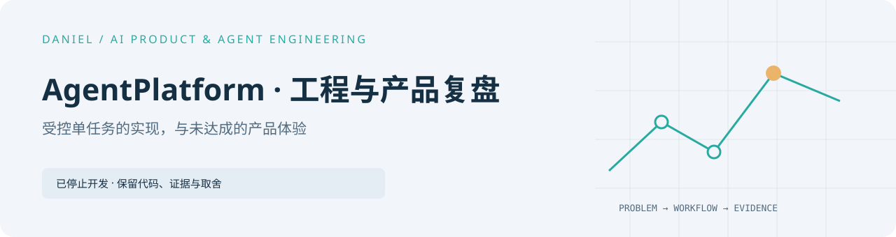

<picture>
  <source media="(prefers-color-scheme: dark)" srcset="docs/assets/cover-dark.svg" />
  
</picture>

# AgentPlatform

[完整作品目录](https://github.com/Daniel-24-life/AIfile)

[English overview](README.en.md)

[只读静态案例页源码](case-study/index.html) · [界面验证](docs/UI_QA.md)


**已停止开发 · 工程与产品复盘案例 · 2026-10-13**

AgentPlatform 原本要接收一个产品目标，让主 Agent 规划并协调多个 Agent，最后交付经验证的软件。**这个核心体验没有实现。** 项目留下了一条受控的单 Task 执行链、本地桌面产品流程，以及一次在 Agent 派发前停止的正式产品试点。这个仓库展示真实代码、可复核的边界和停止原因。

## 一眼看懂：目标与现实


正式试点将真实产品目标保存到桌面 App，但规划请求返回 `RUNTIME_NOT_QUALIFIED`；Agent 调用、开发 Task 和交付均为 **0**。[试点经过](docs/PILOT_CASE_STUDY.md)与[体验地图](docs/EXPERIENCE_MAP.md)解释了停在何处。

| 范围 | 停止时的结论 |
| --- | --- |
| 单任务可信执行内核 | 指定真实任务功能验收 **PASS**；广泛可靠性 **PARTIAL** |
| 本地产品层 | Phase 1.20–1.34 的离线、技术 UI 和开发包验收有记录 |
| 真实产品目标到交付 | **NOT_RUN**；首次正式试点在 Agent 派发前被资格门禁阻断 |
| 动态多 Agent 产品协作 | **未实现**；现有 Architect → Worker → Reviewer 是单 Task 内的串行角色链 |
| 产品价值、质量/速度/成本优势 | **未证明**；没有足够的真实产品和同条件竞品对照 |

**不要把两条路径混为一谈**：单 Task 的受控运行通过了指定功能验收；它没有证明平台能把一个产品目标拆给多个 Agent 并交付产品。状态与证据等级见[验证记录](docs/VERIFICATION_RECORD.md)。

## 已实现的运行链


这条链的关键设计是：用户批准 TaskSpec；平台创建受管 worktree，启动 Codex Worker，再亲自运行测试与确定性 Gate；终审只读，最终交给用户检查分支、Diff 和证据。Agent 的“测试通过”声明不是测试结果，平台也不会自动 commit、push 或 merge。[实现架构](docs/ARCHIVE_ARCHITECTURE.md) · [按步骤读源码](docs/SOURCE_READING_GUIDE.md)

## 产品 UI：它显示了什么

下图来自 Phase 1.34 Windows 开发包的**离线合成夹具**，展示产品历史运行指标界面。图中的“100% 技术完成率”只表示夹具内 1/1 个关联 Task 的技术状态，**不是**真实产品目标完成率，也不是用户业务验收。


产品层实现了目标版本、计划确认、单 Task 关联、有限运行、静态预览和未发布交付。截图展示的是历史指标的只读视图；它无法补上正式规划资格或产品级动态协作。界面元素、数据来源和连接边界见[体验地图](docs/EXPERIENCE_MAP.md#ui-展示的是什么)。

## 值得借鉴，也值得警惕

- **平台拥有验证事实**：Agent 输出经 schema 与语义检查；TestRun 由平台启动；确定性 Gate 失败不能由模型解释放行。
- **写入与运行有边界**：目标仓库须干净；每个 Attempt 使用独立分支和受管 worktree，Codex Builder 另使用 `workspace-write` 沙箱。
- **状态与证据分开**：SQLite 记录任务、运行、目标版本和幂等回执；文件保存日志、Diff 与哈希工件；中断和失败不被改写成成功。
- **产品复盘同样重要**：局部技术验收没有证明用户最在意的端到端体验。项目停止的直接原因和战略判断见[复盘](docs/PROJECT_RETROSPECTIVE.md)。

每项做法的代码入口、复用前提及不该照搬的部分整理在[工程沉淀](docs/ENGINEERING_TAKEAWAYS.md)。

**停止的两个原因**：最重要的是核心体验没有实现；此外，项目所有者认为现有 Agent 产品（包括 Codex）已基本满足自己的需求，继续开发可能只增加一层 token 中转，而没有形成原先期待的价值。后者是产品判断，并非同条件竞品测试结果。

## 技术栈与文档

Electron 36、React 18、TypeScript 5.6、electron-vite 5、Node `node:sqlite`、AJV 8、Vitest 2、ESLint 9；确切依赖以 [`package.json`](package.json) 和 [`pnpm-lock.yaml`](pnpm-lock.yaml) 为准。

| 文档 | 读者能找到什么 |
| --- | --- |
| [实现架构](docs/ARCHIVE_ARCHITECTURE.md) | 组件、两条工作链、安全与执行边界 |
| [体验地图](docs/EXPERIENCE_MAP.md) | 目标与现实、运行步骤、UI、连接边界和缺口 |
| [数据与接口](docs/ARCHIVE_DATA_INTERFACES.md) | SQLite 数据域、Preload/IPC API、schema 契约 |
| [项目复盘](docs/PROJECT_RETROSPECTIVE.md) | 成果、未达成目标、停止原因和经验 |
| [验证记录](docs/VERIFICATION_RECORD.md) | 哪些结论能从代码复核、哪些来自本地历史证据 |
| [项目决定](docs/PROJECT_DECISIONS.md) | 产品目标演化、试点与停止决定 |
| [源码阅读路线](docs/SOURCE_READING_GUIDE.md) | 按任务执行、产品流程、数据证据逐层读代码与测试 |
| [工程沉淀](docs/ENGINEERING_TAKEAWAYS.md) | 可复用的实现、UI 误读风险与重新验证的前提 |
| [TaskSpec 示例](examples/README.md) | 字段、只读上下文与写入范围的区别 |

**阅读建议**：先看体验地图，再按兴趣进入架构或数据接口；想验证事实，读验证记录和去个人化试点；想复用代码，跟随源码阅读路线。设计草案、完整阶段记录及原始讨论保留在本地档案。

## 本地阅读与验证

需要 Windows、Node.js ≥22、pnpm ≥10 和 Git。普通测试使用临时仓库或 fake executable；真实 Agent 执行还需要独立安装并登录 Codex CLI。

静态案例页不依赖 Electron 或外部资源。在仓库根目录运行 `python -m http.server 4184 --bind 127.0.0.1`，访问 <http://127.0.0.1:4184/case-study/>。也可以直接打开 HTML 文件。定向静态检查为 `pnpm test:case-study`。页面只呈现已有公开复盘，不代表项目恢复开发或正式产品试点已通过。

```powershell
pnpm install --frozen-lockfile
pnpm typecheck
pnpm lint
pnpm build
pnpm test
pnpm dev
```

先构建再测试，因为静态预览集成测试会启动构建出的本机预览服务。`pnpm dev` 启动开发版桌面应用；`pnpm package:win` 构建未签名 Windows 开发包。真实模型评测、manual real-runtime、真实 A/B 和 `*:execute` 命令不属于普通测试。展示仓库不包含 Windows 包、用户数据库、受管 worktree、会话原文或全部原始运行证据；可核查范围见[验证记录](docs/VERIFICATION_RECORD.md)。

该仓库是**已停止项目的技术归档**，不是可依赖的生产平台。代码与文档按 [MIT 许可证](LICENSE)开放复用；历史运行证据和私人数据不在公开范围内。
