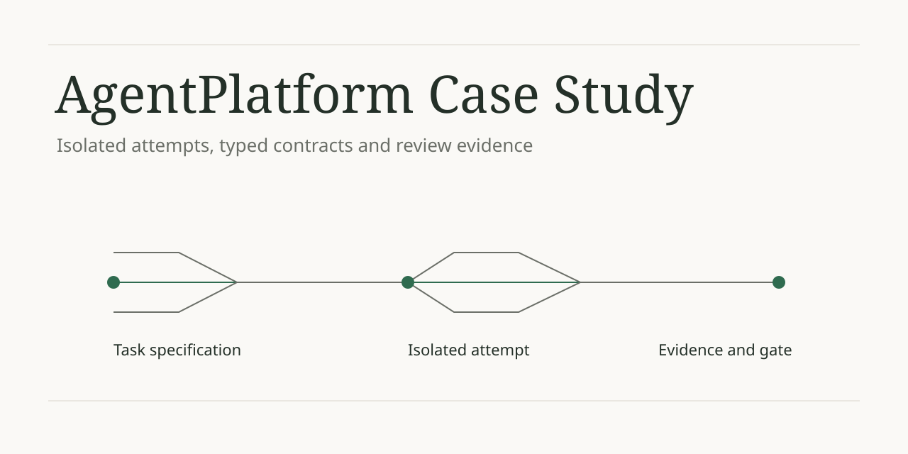
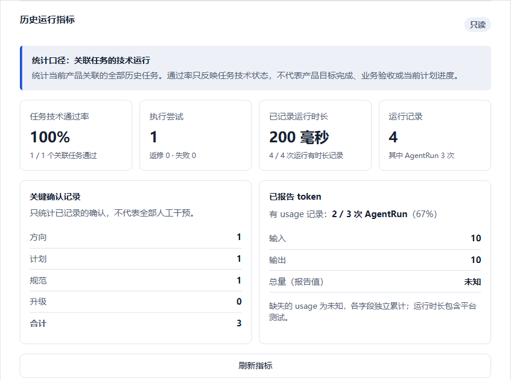
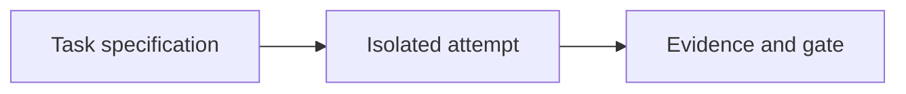

<picture>
  <source media="(prefers-color-scheme: dark)" srcset="docs/cover-dark.svg" />
  <source media="(prefers-color-scheme: light)" srcset="docs/cover-light.svg" />
  
</picture>

# AgentPlatform Case Study

Trace a bounded agent task from specification through an isolated workspace to its evidence and review gate.

[▶ Live demo](https://daniel-24-life.github.io/agentplatform-case-study/) · [中文](README.zh.md) · [](https://github.com/Daniel-24-life/agentplatform-case-study/actions/workflows/case-study.yml) · [MIT](LICENSE) · TypeScript · Node.js 22+

## Demo



The live page presents the retrospective. The screenshot shows the Electron interface with its included fixture.

## Problem

Automated task execution is easier to audit when the workspace, attempted change, and acceptance evidence have distinct contracts. The retrospective documents how those contracts fit together.

## What I built

- Trace the task spec through an isolated attempt.
- Review the typed interfaces and SQLite records used by the prototype.
- Read what shipped in the bounded task path and what remained open in the product.

## How it works



## Run in 60 seconds

```sh
python -m http.server 4183 --bind 127.0.0.1
```

Once the local server starts, open [http://127.0.0.1:4183/case-study/](http://127.0.0.1:4183/case-study/).

## Tests

**4 tests passed.** [Verified GitHub Actions run](https://github.com/Daniel-24-life/agentplatform-case-study/actions/runs/45105690614).

```sh
pnpm install --frozen-lockfile
pnpm test:case-study
pnpm typecheck
```

## Repository layout

| Path | Contents |
| --- | --- |
| [`case-study/`](case-study/) | Static retrospective |
| [`config/`](config/) | Shared TypeScript build settings |
| [`src/`](src/) | Electron process and renderer |
| [`schemas/`](schemas/) | Task and result contracts |

Reference material · [PROJECT_RETROSPECTIVE.md](docs/PROJECT_RETROSPECTIVE.md) · [SOURCE_READING_GUIDE.md](docs/SOURCE_READING_GUIDE.md)

<sub>The screenshot uses a synthetic fixture. The published case study documents a technical prototype, including the product scope left incomplete.</sub>
