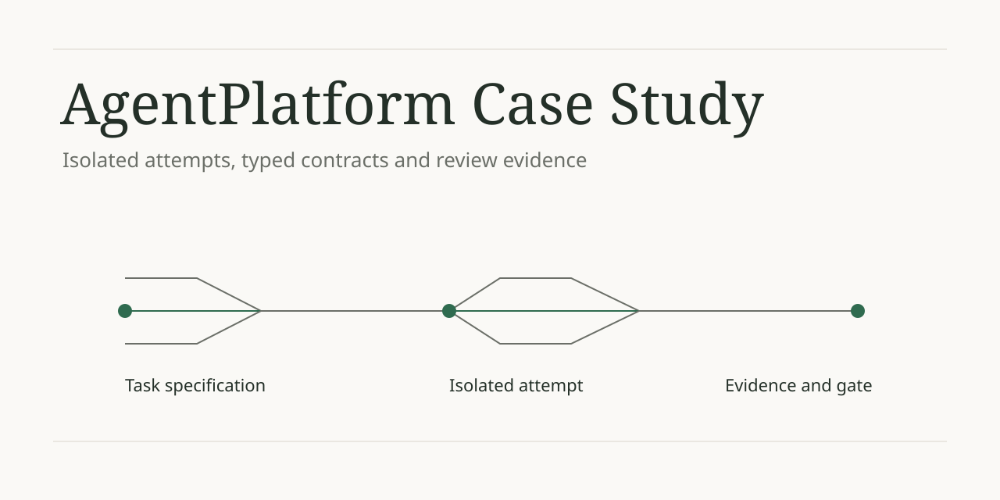
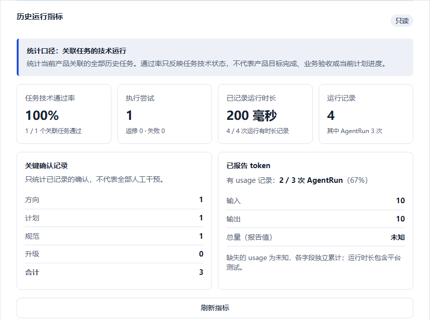
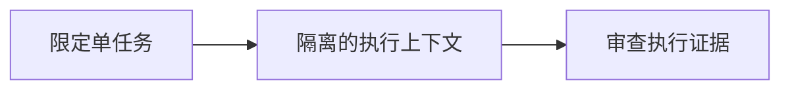

<picture>
  <source media="(prefers-color-scheme: dark)" srcset="docs/cover-dark.svg" />
  <source media="(prefers-color-scheme: light)" srcset="docs/cover-light.svg" />
  
</picture>

# AgentPlatform 工程复盘

复盘任务如何经过规格、工作区隔离、证据归集和验收。

[在线演示](https://daniel-24-life.github.io/agentplatform-case-study/) · [English](README.md) · [](https://github.com/Daniel-24-life/agentplatform-case-study/actions/workflows/case-study.yml) · [MIT](LICENSE) · TypeScript · Node.js 22+

## Demo



在线演示是项目案例页。截图展示 Electron 界面的夹具结果。

## 要解决的问题

执行单个 Agent 任务时，需要关联它的执行环境、变更和复核依据。公开案例将这些步骤串起来。

## 实现

- 沿真实源码回看工作区隔离与任务过程。
- 查看 SQLite 和接口契约。
- 比对已实现的技术路径和未完成的使用体验。

## 工作流程



## 快速运行

```sh
python -m http.server 4183 --bind 127.0.0.1
```

启动后打开 [http://127.0.0.1:4183/case-study/](http://127.0.0.1:4183/case-study/)。

## 测试

实测 **4 项通过**。[通过的 GitHub Actions 运行](https://github.com/Daniel-24-life/agentplatform-case-study/actions/runs/45105690614)。

```sh
pnpm install --frozen-lockfile
pnpm test:case-study
pnpm typecheck
```

## 仓库目录

| 路径 | 内容 |
| --- | --- |
| [`case-study/`](case-study/) | Static retrospective |
| [`config/`](config/) | Shared TypeScript build settings |
| [`src/`](src/) | Electron process and renderer |
| [`schemas/`](schemas/) | Task and result contracts |

延伸阅读 · [PROJECT_RETROSPECTIVE.md](docs/PROJECT_RETROSPECTIVE.md) · [SOURCE_READING_GUIDE.md](docs/SOURCE_READING_GUIDE.md)

<sub>界面截图使用合成夹具。案例记录了已探索的实现与未完成的产品范围。</sub>
