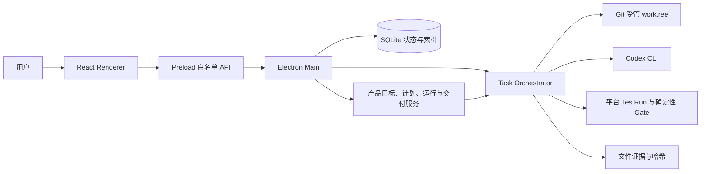

# AgentPlatform 技术架构（停止开发时的实现）

状态：`IMPLEMENTED-SCOPE REVIEW`，2026-10-13。本文只描述源码中能够定位的实现；当时的设计草案包含未来候选，不能据此推断产品已经实现。

## 系统轮廓

AgentPlatform 是 Windows 本地 Electron 应用。它尝试把 Agent 写代码这件事放进由平台掌握的 Git、进程、测试与证据闭环，而不是让 Agent 自报任务完成。

| 层 | 代码入口 | 实际职责 |
| --- | --- | --- |
| 桌面界面 | [`src/renderer/src/`](../src/renderer/src/) | 产品、项目、任务、运行和审查界面；不直接访问文件系统或 Git |
| 白名单边界 | [`src/preload/`](../src/preload/) | 通过 `contextBridge` 暴露固定方法；产品接口验证请求和返回值 |
| Main 与产品服务 | [`src/main/index.ts`](../src/main/index.ts)、[`src/main/products/`](../src/main/products/) | 组装 IPC、产品流程、预览、数据库和运行控制；产品 IPC 检查窗口来源 |
| 任务执行 | [`src/main/orchestrator/task-orchestrator.ts`](../src/main/orchestrator/task-orchestrator.ts) | TaskSpec、Attempt、AgentRun、TestRun、Gate 和只读终审的受控顺序 |
| Git 与进程 | [`src/main/git/git-service.ts`](../src/main/git/git-service.ts)、[`src/main/process/runner.ts`](../src/main/process/runner.ts) | 干净仓库检查、唯一分支/worktree、受限输出、超时与取消；外部命令使用参数数组和 `shell: false` |
| 数据与契约 | [`src/main/db/database.ts`](../src/main/db/database.ts)、[`src/shared/contracts/`](../src/shared/contracts/)、[`schemas/`](../schemas/) | SQLite 迁移、持久事实、类型化 IPC 和 JSON Schema |

## 两条不同的工作链

**已验证的任务内核**：注册干净 Git 仓库 → 创建 Task 并锁定 base SHA → 只读 Architect 产出 TaskSpec → 用户审阅并批准 → 在应用数据目录创建 Attempt worktree → Worker 写入 → 平台执行获批的测试命令 → 确定性 Gate 核查范围、Diff、测试与证据 → 只读 Final Gate。一个受控真实任务通过了这条链；这不构成广泛可靠性证明，见[验证记录](VERIFICATION_RECORD.md)。

**产品层本地流程**：保存和确认目标 → 保存和确认计划 → 绑定已注册仓库 → 将计划关联到**单个** Task → 批准 TaskSpec 后有界运行 → 查看技术状态、静态预览和未发布交付。产品层主要经离线、合成夹具、技术 UI 与打包 App 检验。正式 App 的模型规划资格未打通；首次真实产品尝试在派发前被拒绝，见[试点记录](PILOT_CASE_STUDY.md)。动态把一个产品目标拆给多个并行 Agent 的能力没有实现。

## 关键约束与取舍

- **验证事实归平台**：Worker 输出需要 schema 与语义校验；测试结果只认平台启动的 TestRun。确定性 Gate 失败不能靠模型解释放行。实现见 [`deterministic-gate.ts`](../src/main/gate/deterministic-gate.ts)。
- **隔离有边界**：每个 Attempt 使用独立分支和应用数据目录下的 worktree；worktree 本身不是沙箱。Codex Builder 另用 `workspace-write`，只读角色使用 `read-only`；平台禁用 CLI 内部多 Agent 调度。实现见 [`codex-adapter.ts`](../src/main/adapters/codex/codex-adapter.ts)。
- **不接管用户主 checkout**：目标仓库必须 clean 且 HEAD 与已批准基线一致；平台不自动 commit、push、merge、rebase 或 stash。Git 服务只给出可审查的分支与 Diff。
- **进程结果可追溯**：进程适配器保留输出摘要和文件日志，记录退出、超时、取消与清理结果；持久数据是状态和工件索引，不把模型自述当权威。
- **恢复不假装续跑**：启动时把无法证明仍受控的活跃运行标为 `INTERRUPTED`；历史 Attempt 与证据仍保留。

## 技术栈与验证

代码使用 Electron 36、React 18、TypeScript 5.6、electron-vite 5、Node 内置 `node:sqlite`、AJV 8、Vitest 2 和 ESLint 9；确切版本以 [`package.json`](../package.json) 和锁文件为准。普通测试使用临时 Git 仓库或 fake executable，不依赖真实模型账户。Windows 开发包曾通过阶段技术验收，但仓库不包含被忽略的 `release/` 包。

## 停止时的界限

可信任务内核的指定功能验收为 PASS，广泛可靠性为 PARTIAL；产品层技术验收不能等同用户真实产品验收。正式产品规划、产品级动态多 Agent 协作、新产品从目标到交付的真实完整运行，以及生产发布均未完成。结论边界见[验证记录](VERIFICATION_RECORD.md)，停止原因见[项目复盘](PROJECT_RETROSPECTIVE.md)。
