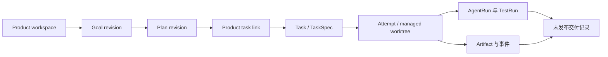

# 数据模型与接口边界

状态：`IMPLEMENTED-SCOPE REVIEW`，2026-10-13。本文是停止开发时的技术导览；权威字段、校验和迁移仍以 [`database.ts`](../src/main/db/database.ts)、[`src/shared/contracts/`](../src/shared/contracts/) 与 [`schemas/`](../schemas/) 为准。它不是对外 HTTP API 文档。

## 持久化位置与权威事实

应用在 Electron `userData` 中存放 `agentplatform.db`、`managed-worktrees/` 和 `artifacts/`；测试可用绝对路径环境变量 `AGENTPLATFORM_USER_DATA_DIR` 指定隔离目录。数据库使用 Node 内置 `node:sqlite`，启动时顺序应用版本化迁移（当前最高版本 14），启用外键。文件日志、Diff 和证据工件在磁盘；SQLite 保留状态、关系、哈希与索引。真实用户数据库和受管 worktree 不属于源码仓库。

以下是帮助阅读的**概念关系**，不是 SQL 外键图；具体字段与约束应以迁移代码为准。



| 数据域 | 主要表 | 用途与边界 |
| --- | --- | --- |
| 任务内核 | `projects`, `tasks`, `attempts`, `runs`, `artifacts`, `events` | 仓库身份与 base SHA、TaskSpec、唯一 Attempt、进程及平台事件；测试/Gate 证据通过运行和工件关系定位 |
| 产品目标 | `product_workspaces`, `product_cycles`, `product_goal_revisions`, `product_decisions`, `product_command_receipts`, `product_events` | 产品及目标版本、用户方向确认、幂等请求回执与有序事件；目标变化不抹去旧版本 |
| 规划与计划 | `product_planning_grants`, `product_planning_actions`, `product_plan_revisions`, `product_plan_receipts` | 单次规划授权与结果、计划修订和确认；有数据结构不表示正式 App 规划路线已取得真实资格 |
| 执行与交付 | `product_task_links`, `product_execution_receipts`, `product_run_actions`, `product_deliveries`, `product_delivery_receipts` | 一个确认计划关联一个 Task、有界运行、未发布交付和内容哈希；交付记录不代表真实业务验收 |
| 本地预览 | `product_preview_sessions` | 静态预览进程、端口、停止状态及证据身份；不是生产部署 |

产品指标从历史 Task/Attempt/Run 派生，不维护另一套可漂移的统计表。缺失 usage 保持未知。数据库迁移保留旧版本结果；本表只概括读者需要的概念，不替代 SQL 定义。

## Renderer 到 Main 的接口

Renderer 通过 `window.platform` 调用 Preload 暴露的固定方法。Preload 将请求送入 Electron IPC；产品 IPC 对调用窗口、输入和返回值执行校验，服务层持有业务规则及数据库写入。类型与方法以 [`src/preload/types.d.ts`](../src/preload/types.d.ts)、[`src/preload/index.ts`](../src/preload/index.ts) 和各合同文件为准。

| API 组 | 主要方法 | 作用 |
| --- | --- | --- |
| `projects`, `tasks`, `runs`, `runtime`, `events` | `chooseAndRegister`, `create`, `startDesign`, `approveSpec`, `startBuild`, `startTests`, `startFinalGate`, `cancel`, `preflight`, `subscribe` 等 | 已有仓库和单 Task 的可信执行、运行控制与事件展示 |
| `products` | `create`, `reviseGoal`, `confirmDirection`, `trash`, `restore`, `getOverview`, `getMetrics`, `readEvents` 等 | 产品目标、版本、回收站、只读指标和事件 |
| `productPlanning` | `authorize`, `revoke`, `requestProposal`, `getState` | 受额度和资格控制的方向/完整计划建议；正式路线未通过资格门禁 |
| `productPlans` | `getState`, `save`, `confirm` | 用户保存并确认开发计划 |
| `productExecution` | `getState`, `bindRepository`, `createTask` | 绑定干净仓库、将确认计划关联到单个 Task |
| `productRuns` | `getState`, `start`, `pause`, `cancel` | 批准规范后的有界产品运行 |
| `productPreviews` | `getState`, `start`, `stop`, `open` | 本机静态构建预览 |
| `productDeliveries` | `getState`, `create` | 保存逐条验收判断和未发布交付证据 |

产品接口返回 `ok: true, value` 或 `ok: false, error: { code, message }`。写操作常带 `requestId` 作为幂等身份，并用预期修订号、计划/目标哈希和 Task/Attempt 身份拒绝过期请求。示例：

```ts
const result = await window.platform.products.create({
  requestId: crypto.randomUUID(),
  name: "Example product",
  initialRequest: "Describe a small local tool"
});
if (!result.ok) throw new Error(result.error.code);
```

这是应用内 API 示例，不是可从浏览器外部调用的网络接口。唯一涉及本机 HTTP 的预览服务只服务受核验的静态输出；源码不提供公共 Web API、云端账号服务或生产发布接口。

## 跨 Agent 与验证契约

[`schemas/`](../schemas/) 中的 JSON Schema 是 TaskSpec、AgentResult、ChangeSet、FinalGate，以及产品目标、计划、提案、运行、预览和交付输出的结构契约。Codex Structured Outputs 使用派生的运行时子集；平台仍会按权威 schema 和跨字段语义校验结果，再决定是否入库。`context_paths` 是只读上下文，`scope.allowed_paths` 才约束写入；测试命令必须是 `{ program, args, cwd, timeout_seconds }`，由平台执行。

核心外部适配是 Codex CLI。Cursor 提案 Worker 保留为显式实验路线；CodeBuddy/WorkBuddy 没有进入正式生产编排。单个 Task 的 Architect、Worker、TestRun、Gate、Reviewer 顺序不能称作产品级动态多 Agent 协作。对应能力证据见[验证记录](VERIFICATION_RECORD.md)。

## 复用这些设计时要注意

可借鉴的是：把用户目标版本、操作回执、执行身份和测试证据分开；用可核对的事实推动状态，而不是只依赖 Agent 文本；在 UI 边界验证请求/响应，并让 Main 负责系统写入。项目未证明这种架构比直接使用成熟 Agent 产品更有价值，见[复盘](PROJECT_RETROSPECTIVE.md)。
