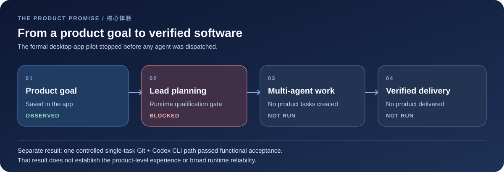
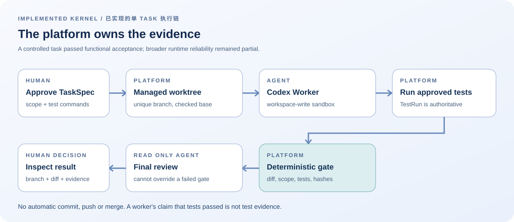
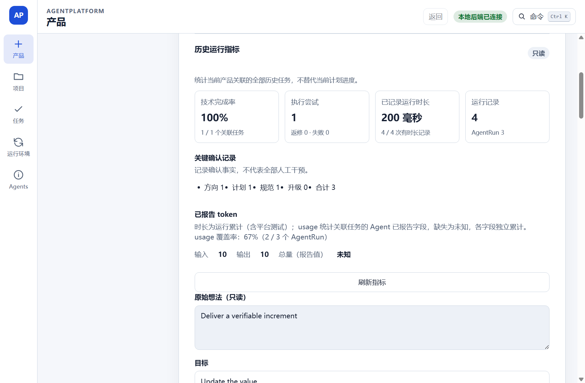
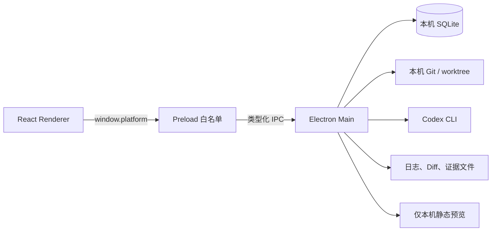

# 体验地图：目标、运行链与停止位置

这页从读者最关心的三个问题进入源码：平台本来要交付什么？已经可验证地做到了什么？第一次正式产品尝试在哪里停下？图示和状态均以停止开发时的实现为准，不是未来路线图。

## 一条目标体验，两条不同的证据链

| 问题 | 已有证据 | 可以得出的结论 |
| --- | --- | --- |
| 单个 Task 能否受控地改代码？ | 一次受控真实任务、UI 验收、[运行核对](VERIFICATION_RECORD.md) | 指定功能路径 `PASS`；广泛可靠性 `PARTIAL` |
| 产品目标能否触发主 Agent 规划与多 Agent 协作？ | [正式 App 试点](PILOT_CASE_STUDY.md)在规划入口返回 `RUNTIME_NOT_QUALIFIED` | 该次尝试在派发前停止；没有证明产品级协作 |
| 用户能否收到可用产品？ | 该次试点的 Task、Attempt、AgentRun 和模型调用均为 0 | 核心产品闭环 `NOT_RUN`，不能从单 Task 验收外推 |

这一区分决定了本仓库所有图、截图和测试数字的解读方式。架构中存在的模块，不自动等于正式 App 已能调用它；离线夹具的技术完成率，不是用户的业务验收。

## 已实现的单 Task 运行逻辑

| 步骤 | 谁拥有决定权或事实 | 代码入口 | 失败时发生什么 |
| --- | --- | --- | --- |
| 批准 TaskSpec | 用户批准范围与测试命令 | [`task-orchestrator.ts`](../src/main/orchestrator/task-orchestrator.ts)、[`task-spec.ts`](../src/shared/core/task-spec.ts) | 未批准的规范不能进入写入阶段 |
| 准备 Attempt | 平台核对干净仓库与 base SHA，并创建唯一分支/worktree | [`git-service.ts`](../src/main/git/git-service.ts) | 基线不符或 dirty 仓库被拒绝，不修改主 checkout |
| 运行 Worker | Codex CLI 在受管 worktree 的 `workspace-write` 沙箱中写入 | [`codex-adapter.ts`](../src/main/adapters/codex/codex-adapter.ts)、[`runner.ts`](../src/main/process/runner.ts) | 超时、取消、进程失败和输出问题分别记录 |
| 测试与确定性 Gate | 平台运行已批准命令，核查 Diff、范围和证据 | [`test-runner.ts`](../src/main/testing/test-runner.ts)、[`deterministic-gate.ts`](../src/main/gate/deterministic-gate.ts) | Worker 自称通过无效；硬门禁失败不能由模型放行 |
| 只读终审与交接 | Reviewer 只读；用户检查分支、Diff 和证据 | [`task-orchestrator.ts`](../src/main/orchestrator/task-orchestrator.ts)、[架构导览](ARCHIVE_ARCHITECTURE.md) | 审查前工作区或证据漂移会被拒绝；平台不自动合并 |

这条链解决的是“怎样让一次 Agent 代码改动可审查”。它不是“主 Agent 自主拆解产品并协调多个 Agent”。单 Task 中的 Architect、Worker、Reviewer 是顺序角色，不能当成产品级动态协作。

## UI 展示的是什么

截图来自 Phase 1.34 的**离线合成夹具**。左侧为产品、项目、任务和运行环境导航；中央只读指标显示关联任务、Attempt、Run、确认记录与已报告的 token 字段。图中的“100% 技术完成率”只表示夹具里 1/1 个关联 Task 的技术状态；截图不来自首次正式产品试点，也不证明交付了产品。指标缺失时保留“未知”，实现见 [`ProductMetricsPanel.tsx`](../src/renderer/src/features/products/ProductMetricsPanel.tsx)。

## 可连接到哪里，边界在哪里

| 边界 | 现在的接口 | 不是哪种接口 |
| --- | --- | --- |
| Renderer ↔ Main | [`window.platform` 与 Preload/IPC](ARCHIVE_DATA_INTERFACES.md#renderer-到-main-的接口)，请求与返回校验 | 对外开放的 HTTP API |
| 平台 ↔ Agent | Codex CLI 进程及结构化输出契约 | 通用 Provider/插件平台；Cursor 仅保留实验路线 |
| 平台 ↔ 代码仓库 | 本机 Git，独立 Attempt 分支与 worktree | 自动 push、PR、merge 或云端 CI |
| 平台 ↔ 预览 | 核验后的本机静态输出 | 生产发布或公网站点 |

数据域、幂等回执、Schema 与示例调用见[数据与接口导览](ARCHIVE_DATA_INTERFACES.md)。这些边界也是复用前应先核对的约束。

## 未实现能力与复盘结论

| 缺口 | 停止时的事实 | 对读者的启发 |
| --- | --- | --- |
| 正式产品规划资格 | 首次正式试点在 `RUNTIME_NOT_QUALIFIED` 停止；不能简单把布尔开关设为 true | 资格与正式 App 的连接本身需要可验证的产品路径 |
| 产品级动态多 Agent 协作 | 没有把一个产品目标动态拆分并集成多 Agent 工作的验收 | 单 Task 角色分离不等于产品协作 |
| 从目标到可用产品的真实交付 | `NOT_RUN`，没有真实业务验收 | 早期应以一个真实目标贯穿整条价值链 |
| 相对现有工具的优势 | 没有同条件质量、速度、成本比较 | 技术控制力不能代替差异化价值的证据 |

停止原因与哪些判断属于推断，见[项目复盘](PROJECT_RETROSPECTIVE.md)；若要从源码追踪某一项，按[阅读路线](SOURCE_READING_GUIDE.md)进入。这个仓库保留可复核的实现和部分去个人化记录，原始运行材料仍在本地档案，见[证据边界](VERIFICATION_RECORD.md)。
